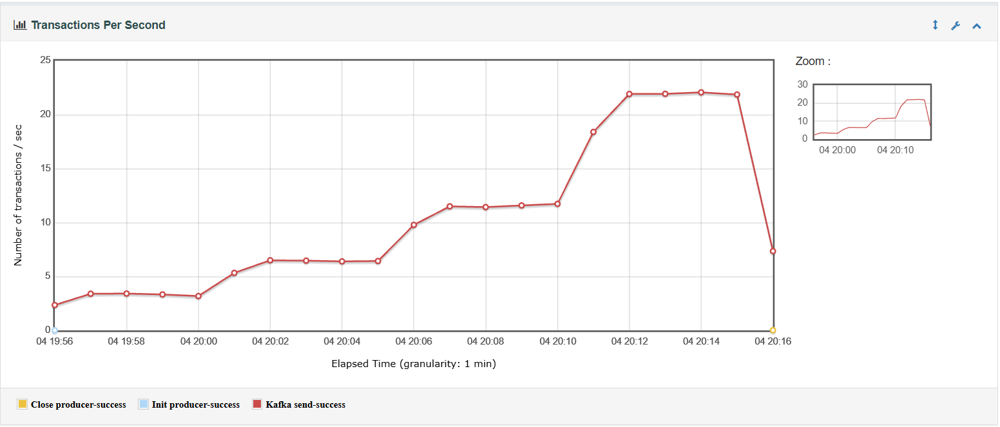
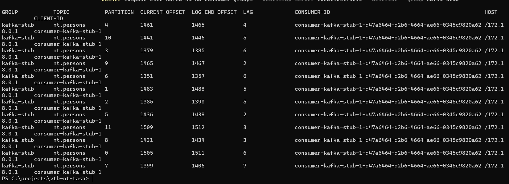
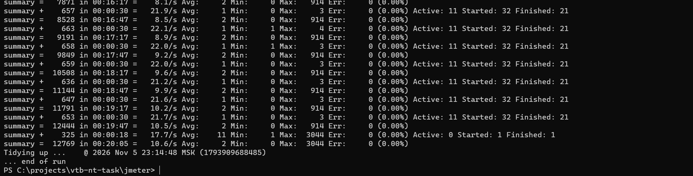
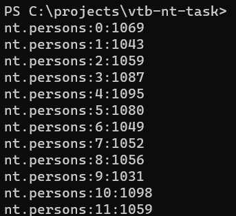
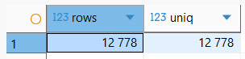
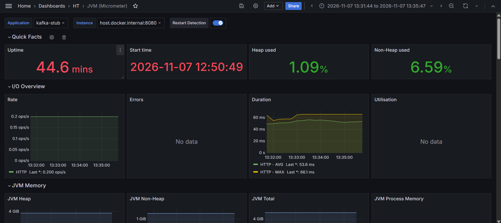
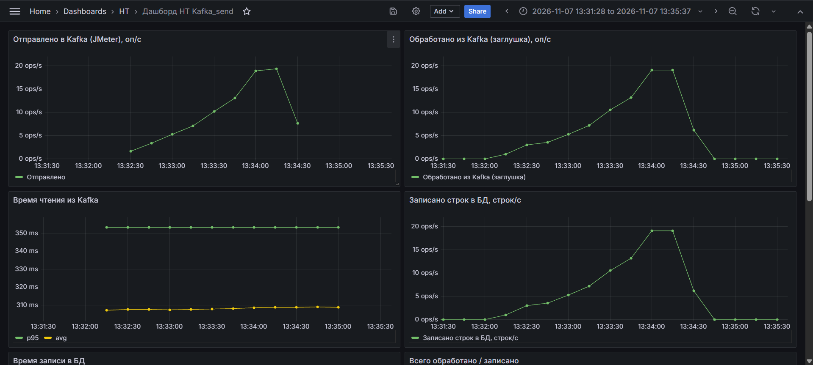
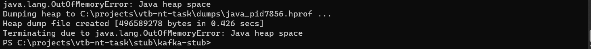

# Тестовое задание НТ: Kafka → заглушка → PostgreSQL

JMeter подаёт ступенчатую нагрузку в Kafka. Заглушка на Spring Boot читает топик в 12 потоков и пишет каждое сообщение строкой в PostgreSQL. Метрики JVM, заглушки и JMeter собираются в Prometheus и отображаются в Grafana.

```
JMeter (Groovy + kafka-clients) ──► Kafka: nt.persons, 12 партиций ──► kafka-stub, 12 потоков ──► PostgreSQL: persons
      │ :9270/metrics                                                     │ :8080/actuator/prometheus
      └──────────────────────────► Prometheus :9090 ◄─────────────────────┘
                                         │
                                    Grafana :3000
```

## Содержание репозитория

| Путь | Что это | Задание |
|---|---|---|
| `docker-compose.yml` | Zookeeper, Kafka, PostgreSQL, Prometheus, Grafana | 1.1, 3, 4 |
| `db/init.sql` | Таблица `persons`, создаётся при первом запуске Postgres | 1.1 |
| `jmeter/kafka_load.jmx` | Сценарий нагрузки | 1.2, 4 |
| `jmeter/data/` | Справочники фамилий, имён и отчеств (мужская и женская формы) | 1.2 |
| `stub/kafka-stub/` | Заглушка: Spring Boot 4.0.9, Java 17 | 1.3, 3, 4, 6 |
| `monitoring/prometheus/prometheus.yml` | Что и откуда собирает Prometheus | 3, 4 |
| `monitoring/grafana/` | Источник данных и два дашборда, подключаются автоматически | 3, 4 |
| `scripts/run-stub.bat` | Запуск JAR с ограничением кучи и дампом памяти при OOM | 6 |
| `docs/THEORY.md` | Ответы на теоретические вопросы | 2 |
| `docs/img/` | Скриншоты результатов | — |

## Как запустить

**Нужно:** Docker Desktop, JDK 17, JMeter 5.6.3.

**1. Стенд**
```
docker compose up -d
docker compose exec kafka kafka-topics --bootstrap-server localhost:9092 --create --topic nt.persons --partitions 12 --replication-factor 1
```
Таблица `persons` создаётся сама из `db/init.sql`. Если после перезапуска компьютера Kafka падает на старте с `NodeExistsException` (Zookeeper ещё держит прошлую сессию брокера), её поднимает `restart: on-failure`. Нужно подождать около 30 секунд.

**2. Заглушка**
```
cd stub\kafka-stub
.\mvnw.cmd -DskipTests package
cd ..\..
scripts\run-stub.bat
```

**3. JMeter**
- `kafka-clients-3.7.0.jar` положить в `lib\` JMeter;
- через Plugins Manager установить **Custom Thread Groups** и **Prometheus Listener**;
- в `bin\user.properties` добавить:
  ```
  prometheus.ip=0.0.0.0
  prometheus.port=9270
  prometheus.delay=15
  ```
  По умолчанию плагин слушает только `127.0.0.1`, и Prometheus из Docker до него не достучится.

Запуск в консольном режиме:
```
cd jmeter
jmeter.bat -n -f -t kafka_load.jmx -l results.jtl -e -o report
```

**4. Мониторинг**
- Grafana: http://localhost:3000 (admin / admin), папка **НТ**, дашборды «JVM (Micrometer)» и «Дашборд НТ Kafka_send»;
- Prometheus: http://localhost:9090/targets, цели `kafka-stub` и `jmeter` должны быть в состоянии UP.

---

## Задание 1.1. Kafka, Zookeeper, PostgreSQL

- Образы Confluent `cp-zookeeper` и `cp-kafka` 7.6.1 (Apache Kafka 3.6) и `postgres:16`.
- **Два listener'а у Kafka.** `INTERNAL://kafka:29092` для контейнеров и `EXTERNAL://localhost:9092` для клиентов на хосте (JMeter, заглушка, Offset Explorer). Брокер сообщает клиенту адрес, по которому к нему подключаться, поэтому каждой стороне нужен свой.
- `KAFKA_AUTO_CREATE_TOPICS_ENABLE=false`. Топик создаётся явно, с нужным числом партиций. Иначе опечатка в имени топика молча создала бы новый топик с одной партицией.
- **Топик `nt.persons`: 12 партиций.** Партиция — единица параллелизма: в группе потребителей её читает только один поток. Расчёт числа потоков — в разделе 1.3.
- **Таблица `persons`:**

  | Колонка | Тип | |
  |---|---|---|
  | `id` | `BIGSERIAL PRIMARY KEY` | номер строки |
  | `msg_id` | `VARCHAR(36) NOT NULL UNIQUE` | из сообщения. `UNIQUE` защищает от дублей при повторной доставке |
  | `full_name` | `VARCHAR(255)` | ФИО кириллицей |
  | `inn` | `VARCHAR(12)` | ИНН ФЛ |
  | `time` | `TIMESTAMP(0)` | время записи, обрезанное до минуты: `2026-11-05 22:25` |

## Задание 1.2. Скрипт JMeter

**Структура сценария**
- **setUp Thread Group:** один раз создаёт `KafkaProducer` (`acks=all`) и загружает справочники ФИО в `props`. Продюсер потокобезопасен, поэтому один экземпляр общий для всех потоков, а подключение к Kafka не создаётся на каждый запрос.
- **Load (Concurrency Thread Group + Throughput Shaping Timer):** JSR223-сэмплер `Kafka send` на Groovy.
- **tearDown:** ждёт 3 секунды, пока потоки нагрузки закончат начатые отправки, затем делает `flush()` и `close()` продюсера.

**Генерация сообщения**
- `msg_id`: `UUID.randomUUID()`, 36 символов, новый на каждый запрос.
- **ИНН ФЛ:** код региона 01–99, инспекция 01–99, 6 случайных цифр, затем две контрольные цифры по алгоритму ФНС (веса `7,2,4,10,3,5,9,4,6,8` и `3,7,2,4,10,3,5,9,4,6,8`, остаток от деления на 11, затем на 10). Пример из задания `675786333117` этот алгоритм проходит.
- **ФИО:** сначала случайно выбирается род, затем фамилия, имя и отчество **отдельно** из справочников этого рода. Фамилии и отчества хранятся парами «мужская;женская», поэтому сочетание вроде «Закроев Мария Геннадьевич» невозможно.
- **Ключ сообщения = `msg_id`.** Партиция выбирается по хешу ключа, поэтому сообщения равномерно расходятся по всем 12 партициям (в прогоне от 1031 до 1098 сообщений на партицию).
- Отправка синхронная: `send().get(10 s)`. Время сэмпла — время до подтверждения брокером, а не до постановки в буфер.

Пример сообщения:
```json
{"msg_id":"b6528bd7-5677-414e-a39f-b14e424fe5e6","full_name":"Селезнёв Артём Дмитриевич","inn":"419379322258"}
```

**Профиль нагрузки.** Throughput Shaping Timer задаёт интенсивность, а Concurrency Thread Group через `${__tstFeedback(tst,5,50,10)}` сама подбирает число потоков, нужное для этой интенсивности (от 5 до 50).

| Ступень | План | Длительность |
|---|---|---|
| 1 | 5 оп/с | 5 мин |
| 2 | 7 оп/с | 5 мин |
| 3 | 12 оп/с | 5 мин |
| 4 | 23 оп/с | 5 мин |



**Корректное завершение теста.** Когда расписание таймера заканчивается, он останавливает тест и прерывает потоки, которые ждут подтверждения от брокера. Такие сэмплы получали `InterruptedException` и записывались как ошибки, хотя сообщение было доставлено. В сэмплере они перехватываются и исключаются из статистики через `SampleResult.setIgnore()`, а флаг прерывания восстанавливается. Настоящие ошибки Kafka по-прежнему считаются ошибками.

## Задание 1.3. Заглушка

`stub/kafka-stub`: Spring Boot 4.0.9, spring-kafka, JdbcTemplate.

**Обработка сообщения** (`PersonListener`):
1. Разбор JSON (Jackson), затем реализуем задержку: чтение длится **не меньше 300 мс** от его начала.
2. `INSERT ... ON CONFLICT (msg_id) DO NOTHING` (`PersonRepository`), затем реализуем задержку: запись длится **не меньше 50 мс** от её начала.
3. Метод завершился без исключения → Spring коммитит оффсет.

Задержка реализована не фиксированным `sleep`, а ожиданием только оставшегося времени: если разбор занял 5 мс, ждём ещё 295. Операция длится не меньше заданного времени, но без лишнего ожидания.

**Сколько нужно потоков.** Один поток тратит не меньше 300 + 50 = 350 мс на сообщение, то есть максимум ~2,86 сообщ/с. На пике 23 сообщ/с нужно не меньше 23 × 0,35 = **8,05** потока. Выбрано **12 партиций и `concurrency: 12`**: ~34 сообщ/с, запас около 48%.

Проверено на практике: с одним потоком уже на первой ступени (5 оп/с) лаг растёт примерно на 2 сообщения в секунду, через ~25 секунд он был 54 и продолжал расти:



Пул соединений Hikari увеличен до 16 (по умолчанию 10). Иначе 12 потоков стояли бы в очереди за соединением к БД.

**Без потерь данных:**
- `enable-auto-commit: false`, `ack-mode: record`: оффсет коммитится только после успешной записи в БД. Если заглушка упадёт посреди обработки, сообщение будет прочитано повторно;
- повторная доставка не создаёт дубль благодаря `UNIQUE (msg_id)` и `ON CONFLICT DO NOTHING`. Итог: ровно одна строка на сообщение;
- `max-poll-records: 10`: пачка обрабатывается за ~3,5 с, что намного меньше `max.poll.interval.ms` (5 мин), и ребалансировки из-за медленной обработки не будет.

## Результаты боевого прогона (5 ноября)

JMeter, 20 минут, профиль 5 → 7 → 12 → 23 оп/с, заглушка в 12 потоков. Перед прогоном топик пересоздан, а таблица очищена.

| Где | Сколько |
|---|---|
| Отправлено JMeter (успешных сэмплов) | 12 769, ошибок 0 |
| Сообщений в Kafka (сумма по 12 партициям) | **12 778** |
| Строк в БД | **12 778** |
| Уникальных `msg_id` в БД | **12 778** |
| Лаг после окончания | 0 |

**Kafka = БД = уникальных `msg_id`: потерь и дублей нет.**

Разница в 9 сообщений между JMeter и Kafka — это сэмплы, у которых при остановке теста прервалось ожидание подтверждения и которые исключены из статистики. Сами сообщения дошли до Kafka и записались в БД. JMeter учитывает то, что успел подтвердить, а полная картина видна в Kafka и в БД.





**Фактическая интенсивность** по графику TPS из HTML-отчёта JMeter: ~3,4 / 6,5 / 11,5 / 22 оп/с против плановых 5 / 7 / 12 / 23. На ступенях 2–4 отклонение 4–7%, на первой около 30%. Вероятные причины: паузы Throughput Shaping Timer рассчитываются через `sleep`, а точность таймера Windows около 15 мс; кроме того, на старте ступени Concurrency Thread Group добирает потоки по обратной связи. Этот недобор интенсивности не исследован до конца.

## Задание 2. Теория
См. [docs/THEORY.md](docs/THEORY.md).

## Задание 3. Actuator → Prometheus → Grafana

- В заглушке подключены `spring-boot-starter-actuator` и `micrometer-registry-prometheus`. Открыты эндпоинты `health`, `info`, `metrics`, `prometheus`, `threaddump`, `heapdump`. Ко всем метрикам добавлена метка `application=kafka-stub`.
- Prometheus забирает `/actuator/prometheus` раз в 5 секунд (`host.docker.internal:8080`, заглушка работает на хосте).
- Grafana: источник Prometheus и дашборды подключаются из `monitoring/grafana/provisioning` при старте контейнера.
- Дашборд **JVM (Micrometer)** (grafana.com, ID 4701): память heap и non-heap по пулам (Eden, Survivor, Old Gen, Metaspace), паузы и частота GC, скорость аллокаций, потоки и их состояния, CPU, загруженные классы, буферы.



## Задание 4. Метрики JMeter и заглушки

Четыре обязательные метрики описывают работу **заглушки**: JMeter видит только отправку и не знает, что происходит дальше. Поэтому они считаются в самой заглушке через Micrometer, а JMeter через Prometheus Listener отдаёт метрики отправки.

| Метрика | Источник | В Prometheus |
|---|---|---|
| Отправлено в Kafka, оп/с | JMeter | `jmeter_requests_total` (counter) |
| Время отправки | JMeter | `jmeter_rt` (summary) |
| **Количество обработанных сообщений из Kafka** | заглушка | `stub_kafka_messages_processed_total` (counter) |
| **Время чтения сообщения из Kafka** | заглушка | `stub_kafka_read_seconds` (histogram) |
| **Количество строк, записанных в БД** | заглушка | `stub_db_rows_written_total` (counter) |
| **Время записи строки в БД** | заглушка | `stub_db_write_seconds` (histogram) |
| Лаг потребителя | Kafka-клиент | `kafka_consumer_fetch_manager_records_lag` |

`processed` и `rows_written` — разные счётчики: если повторно доставленное сообщение отброшено по `ON CONFLICT`, оно обработано, но строка не записана.

Дашборд **«Дашборд НТ Kafka_send»**: отправлено, обработано и записано в секунду (при нормальной работе одна линия), время чтения и записи (p95 и среднее), итоговые счётчики, лаг.



*Скриншот снят на коротком проверочном прогоне со ступенями по 30 секунд, поэтому вместо ступенек видна плавная «горка»: окно `rate(...[30s])` равно длине ступени и смешивает соседние ступени. На 5-минутных ступенях боевого профиля они видны чётко.*

Как читать графики:
- **p95 чтения ≈ 350 мс при среднем ≈ 308 мс.** `histogram_quantile` интерполирует внутри корзины гистограммы, поэтому точность перцентиля ограничена шириной корзины. Среднее (`sum / count`) точное.
- **Время записи 50–67 мс.** 50 мс — нижняя граница эмуляции. Под нагрузкой 12 потоков коммит в Postgres иногда занимает больше, и тогда в метрику попадает реальное время. В начале теста бывают выбросы по 200+ мс: это прогрев соединений пула и первые запросы.

## Задание 5. Git
Репозиторий: https://github.com/AlexeyDovbnya/vtb-nt-task. Работа коммитилась поэтапно, история отражает ход выполнения.

## Задание 6. JAR и дамп памяти при OOM

```
cd stub\kafka-stub
.\mvnw.cmd -DskipTests package     # → target\kafka-stub-0.0.1-SNAPSHOT.jar (fat JAR со всеми зависимостями)
```
`scripts\run-stub.bat` запускает JAR с флагами:

| Флаг | Зачем |
|---|---|
| `-Xms256m -Xmx512m` | явный размер кучи. Без `-Xmx` JVM берёт 1/4 оперативной памяти |
| `-XX:+HeapDumpOnOutOfMemoryError` | при OOM автоматически сохранить дамп кучи |
| `-XX:HeapDumpPath=<проект>\dumps` | куда сохранять дамп |
| `-XX:+ExitOnOutOfMemoryError` | после OOM завершить процесс: приложение в непредсказуемом состоянии, пусть его перезапустят |

**Проверка.** `POST /debug/oom` (`DebugController`, только для демонстрации) забивает кучу до `OutOfMemoryError`:
```
Invoke-WebRequest -Method Post http://localhost:8080/debug/oom
```
Результат:
```
java.lang.OutOfMemoryError: Java heap space
Dumping heap to C:\projects\vtb-nt-task\dumps\java_pid7856.hprof ...
Heap dump file created [496589278 bytes in 0.426 secs]
Terminating due to java.lang.OutOfMemoryError: Java heap space
```
Дамп открывается в Eclipse MAT или VisualVM. Отчёт Leak Suspects указывает на `ArrayList` из `DebugController.LEAK`, который держит массивы `byte[]`.



Дамп можно снять и без OOM: `GET /actuator/heapdump` или `jcmd <pid> GC.heap_dump <файл>`.
